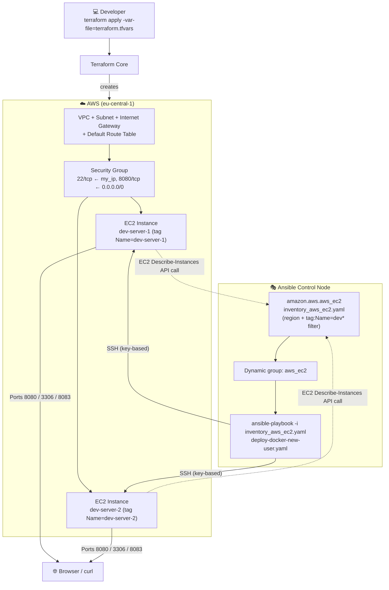
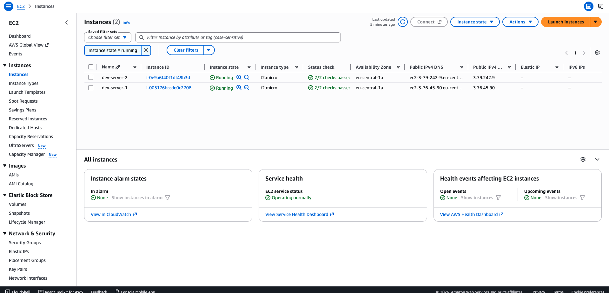
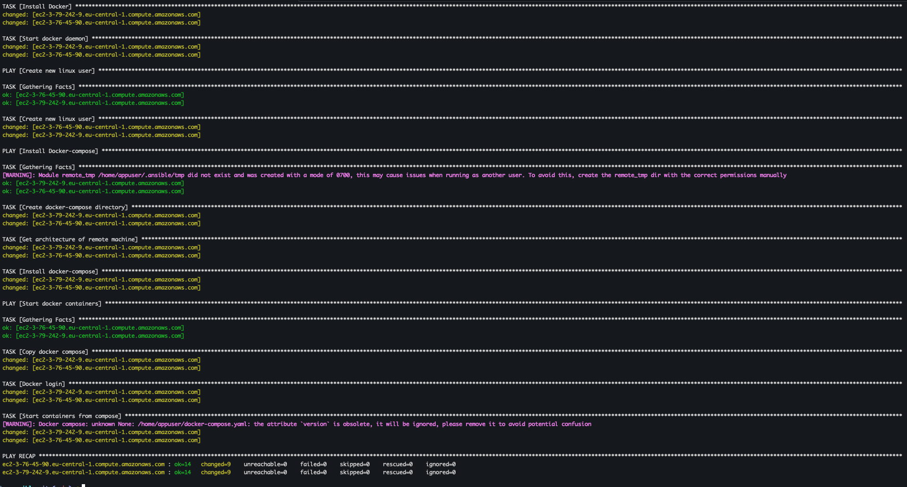
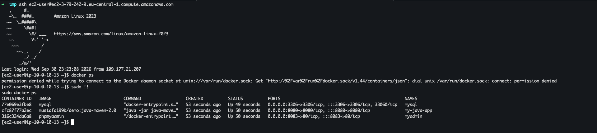

# 🚀 Ansible Configure Dynamic Inventory


**Terraform** is an infrastructure as code (IaC) tool that lets you build, change, and version infrastructure safely and efficiently. It works with resources from cloud providers as well as on-prem services, describing infrastructure using a high-level configuration language called **HCL (HashiCorp Configuration Language)**. Terraform generates an execution plan describing what it will do to reach the desired state, and then executes it to build the described infrastructure, keeping track of the real-world resources it manages in a **state file**.

**Ansible Automation** is an open-source, agentless IT automation engine that automates provisioning, configuration management, application deployment, and orchestration across large fleets of servers. It describes the *desired state* of a system using simple, human-readable YAML files called **playbooks**, and pushes those changes to managed nodes over standard **SSH** — without requiring any agent, daemon, or extra software installed on the target machines. Because every module is designed to be **idempotent**, running the same automation twice produces the same end state without unintended side effects, which makes Ansible a safe, repeatable and auditable way to manage infrastructure at scale.

## 📖 Overview

This project demonstrates how to eliminate one of the most common pain points when combining **Terraform** and **Ansible**: manually copying server IP addresses into a static Ansible inventory file every time infrastructure changes. Instead, this project configures Ansible's **`aws_ec2` dynamic inventory plugin**, which queries the **AWS EC2 API directly** at runtime and builds the inventory on the fly — automatically discovering every matching EC2 instance, its IP address, and its tags, with zero manual bookkeeping.

Two EC2 instances are first provisioned with **Terraform**, then Ansible's dynamic inventory plugin discovers both of them under a common `aws_ec2` host group (filtered by a `Name` tag), and a single playbook installs **Docker** and **Docker Compose**, creates a dedicated Linux user, and deploys a multi-container application stack identically across both servers — proving the same automation scales from one server to a whole fleet without touching a single hardcoded IP.

### ✨ Ansible Automation key features

- 🔓 **Agentless architecture** — connects to managed nodes purely over SSH (or WinRM for Windows), so there is nothing to install or maintain on the target servers
- 📝 **Human-readable YAML playbooks** — automation logic is expressed as simple, declarative YAML instead of custom scripting
- 🔁 **Idempotency** — tasks can be run repeatedly and will only change the system when it drifts from the desired state
- 🧩 **Modular building blocks** — reusable **Modules**, **Roles** and **Collections** let automation be composed, shared and version-controlled
- ⚡ **Ad-hoc command execution** — one-off tasks (e.g. `ping`, `shell`, `yum`) can be run instantly across a fleet without writing a full playbook
- 🗂️ **Dynamic inventory management** — instead of a static list of hosts, an **inventory plugin** can query a live source of truth (like the AWS EC2 API) and build the inventory automatically, grouping and filtering hosts by tags, region or other attributes
- 🔌 **Extensibility** — custom modules and plugins (e.g. `amazon.aws.aws_ec2`, `community.docker.docker_compose_v2`) can extend Ansible's behaviour to fit any infrastructure need
- 🏪 **Ansible Galaxy** — a public registry for discovering and sharing community-built roles, modules and inventory plugins
- 🔒 **Secure secrets handling** — sensitive data (passwords, keys, tokens) can be externalized into `vars_files` and encrypted at rest using **Ansible Vault**
- 🎯 **Fleet-wide orchestration** — a single playbook run (`hosts: aws_ec2`) can target every host returned by the dynamic inventory simultaneously, making the automation effortlessly scale from one server to hundreds

## Demo Project

Ansible Configure Dynamic Inventory

## Technologies used

- Ansible
- Terraform
- AWS
- Docker
- Linux

## Project Description

- Create EC2 Instance with Terraform
- Write Ansible AWS EC2 Plugin to dynamically sets inventory of EC2 servers that Ansible should manage, instead of hard-coding server addresses in Ansible inventory file

## 📁 Repository structure

```text
ansible-configure-dynamic-inventory/
├── NOTES.md                          # Personal study notes covering the full Ansible learning path
├── README.md                         # This file 📄
├── .gitignore                        # Excludes tfstate, .terraform/, *.tfvars & project-vars from git
├── images/                           # Screenshots captured while running the demo
│   ├── ec2-instances-aws-console.png
│   ├── ansible-playbook-terminal.png
│   └── ec2-server-docker-terminal.png
├── terraform/                        # Infrastructure as Code - provisions 2 AWS EC2 instances
│   ├── providers.tf                    # AWS provider & required Terraform version
│   ├── main.tf                         # VPC, subnet, security group & 2 EC2 instances
│   ├── entry-script.sh                  # Reference: manual bash equivalent of the Docker install steps
│   ├── example.tfvars                   # Template committed to the repo - copy to terraform.tfvars
│   └── terraform.tfvars                 # Local, git-ignored real values (region, CIDR, IP, key paths)
├── ansible/                           # Configuration Management - discovers & configures the EC2 fleet
│   ├── ansible.cfg                      # Enables the aws_ec2 plugin & sets remote_user/private_key_file
│   ├── hosts                             # Legacy static inventory file (kept for reference/manual runs)
│   ├── inventory_aws_ec2.yaml            # Dynamic inventory plugin config - the heart of this project
│   ├── deploy-docker-new-user.yaml       # Playbook - installs Docker/Compose & deploys the stack
│   ├── project-vars                       # Local, git-ignored vars file (docker_password)
│   └── example-project-vars               # Template committed to the repo - copy to `project-vars`
└── bootcamp-java-mysql-project/       # The application stack that gets deployed to every EC2 instance
    ├── docker-compose-full.yaml         # 3-tier stack: Java app + MySQL + phpMyAdmin (used by Ansible)
    ├── docker-compose.yaml              # Local dev compose file (MySQL + phpMyAdmin only)
    ├── Dockerfile                        # Builds the Java application image
    └── src/                               # Java application source code
```

## 🏗️ Architecture overview



- **Terraform** provisions the shared network (VPC, subnet, internet gateway, route table, security group) plus **two** EC2 instances (`dev-server-1`, `dev-server-2`), each tagged with a unique `Name`
- Instead of a static `hosts` file, **Ansible's `amazon.aws.aws_ec2` inventory plugin** queries the live AWS API for any instance matching the configured region and tag filter, and automatically places matching hosts into the `aws_ec2` group
- The same **single playbook** then targets `hosts: aws_ec2`, running identically against every instance the plugin discovers — whether that's 2 servers today or 20 tomorrow, with **no playbook or inventory file changes required**
- Each instance ends up running the same three-container stack (Java app + MySQL + phpMyAdmin), independently reachable on ports **8080**, **3306** and **8083**

## 🧭 Implementation Guide

### 1. Prerequisites

Before running this automation, make sure you have the following in place:

- ✅ **Terraform installed** on your local/control machine, see [Terraform's install guide](https://developer.hashicorp.com/terraform/install)

  ```bash
  # macOS
  brew tap hashicorp/tap
  brew install hashicorp/tap/terraform
  ```

- ✅ **Ansible installed** on your local/control machine

  ```bash
  # macOS
  brew install ansible

  # or via pip (Ansible is written in Python)
  pip install ansible
  ```

- ✅ The **`amazon.aws`** Ansible Collection installed, since the `aws_ec2` inventory plugin lives in it, see [Ansible Collection for Amazon AWS](https://docs.ansible.com/ansible/latest/collections/amazon/aws/index.html)

  ```bash
  ansible-galaxy collection install amazon.aws

  # the collection's aws_ec2 plugin also needs boto3 & botocore installed
  pip install boto3 botocore
  ```

- ✅ An **AWS account** with credentials configured locally (e.g. via `aws configure` or environment variables) — both Terraform's AWS provider **and** the `aws_ec2` inventory plugin authenticate using the standard AWS credential chain, see [Terraform AWS Provider docs](https://registry.terraform.io/providers/hashicorp/aws/latest/docs)
- ✅ An **SSH key pair** generated locally, whose public key path is referenced in [terraform.tfvars](terraform/terraform.tfvars) and gets attached to both EC2 instances via `aws_key_pair`

  ```bash
  ssh-keygen -t ed25519 -f ~/.ssh/id_ed25519
  ```

- ✅ A **Docker Hub** (or other private registry) account, since the deployment playbook authenticates with `docker_login` before pulling the application image
- ✅ Local copies of the two git-ignored variable files, created from the templates committed to the repo:

  ```bash
  cd terraform
  cp example.tfvars terraform.tfvars
  # then edit terraform.tfvars with your own region, CIDR blocks, IP and key paths

  cd ../ansible
  cp example-project-vars project-vars
  # then edit project-vars with your own docker_password
  ```

### 2. Provision two AWS EC2 instances with Terraform

[terraform/main.tf](terraform/main.tf) declares the shared networking (VPC, subnet, internet gateway, default route table, default security group) and a dynamically resolved **Amazon Linux 2023** AMI, then provisions **two** identically configured EC2 instances, each with its own `Name` tag so the dynamic inventory plugin can later tell them apart and group them:

```hcl
resource "aws_instance" "myapp-server-one" {
  ami = data.aws_ami.latest-amazon-linux-image.id
  instance_type = var.instance_type

  subnet_id = aws_subnet.myapp-subnet-1.id
  vpc_security_group_ids = [aws_default_security_group.default-sg.id]
  availability_zone = var.avail_zone

  associate_public_ip_address = true
  key_name = aws_key_pair.ssh-key.key_name

  tags = {
    Name: "${var.env_prefix}-server-1"
  }
}

resource "aws_instance" "myapp-server-two" {
  ami = data.aws_ami.latest-amazon-linux-image.id
  instance_type = var.instance_type

  subnet_id = aws_subnet.myapp-subnet-1.id
  vpc_security_group_ids = [aws_default_security_group.default-sg.id]
  availability_zone = var.avail_zone

  associate_public_ip_address = true
  key_name = aws_key_pair.ssh-key.key_name

  tags = {
    Name: "${var.env_prefix}-server-2"
  }
}
```

The security group opens SSH (22) only to the operator's own IP and the application port (8080) to the world, while outputs expose both instances' public IPs and the resolved AMI ID for convenience:

```hcl
output "ec2-public_ip_1" {
  value = aws_instance.myapp-server-one.public_ip
}

output "ec2-public_ip_2" {
  value = aws_instance.myapp-server-two.public_ip
}
```

Environment-specific values are supplied through [terraform/example.tfvars](terraform/example.tfvars) (copied locally to `terraform.tfvars`, which is git-ignored):

```ini
# Update these values to match your AWS setup and workstation IP
vpc_cidr_block     = "10.0.0.0/16"
subnet_cidr_block  = "10.0.10.0/24"
avail_zone         = "us-east-1a"
env_prefix         = "dev"
my_ip              = "YOUR_IP/32"
instance_type      = "t2.micro"
public_key_location = "PATH_TO_PUB_KEY"
private_key_location = "PATH_TO_PRIV_KEY"
```

Initialize and apply the Terraform configuration:

```bash
cd terraform
terraform init
terraform plan -var-file=terraform.tfvars
terraform apply -var-file=terraform.tfvars
```

Once applied, both instances show up as `running` in the AWS console, tagged `dev-server-1` and `dev-server-2`:



### 3. Configure the `aws_ec2` dynamic inventory plugin

Rather than hand-writing a static inventory with two hardcoded IPs, Ansible's **inventory plugins** can generate the inventory automatically from an external source of truth — here, the AWS EC2 API itself. To see every inventory plugin available out of the box:

```bash
ansible-doc -t inventory -l
```

The plugin must first be enabled, either in the Ansible config or directly in the inventory file. In this project, [ansible/ansible.cfg](ansible/ansible.cfg) enables it and also configures the SSH connection defaults so they don't need to be repeated per host:

```ini
[defaults]
host_key_checking = False
inventory = inventory_aws_ec2.yaml

enable_plugins = aws_ec2

remote_user = ec2-user
private_key_file = ~/.ssh/id_ed25519
```

The plugin itself is configured through [ansible/inventory_aws_ec2.yaml](ansible/inventory_aws_ec2.yaml) — note the filename **must** end in `_aws_ec2.yaml` (or `.yml`) for Ansible to recognize it as an `aws_ec2` inventory source:

```yaml
---
plugin: aws_ec2
regions: 
  - eu-central-1
filters:
  tag:Name: dev*
# keyed_groups:
#   - key: tags.Name
#     prefix: tag_Name_
```

- **`plugin: aws_ec2`** selects the `amazon.aws.aws_ec2` inventory plugin
- **`regions`** scopes the EC2 `describe-instances` API call to a specific AWS region, keeping discovery fast and avoiding cross-region noise
- **`filters`** narrows the returned instances using native [EC2 API filters](https://docs.aws.amazon.com/AWSEC2/latest/APIReference/API_DescribeInstances.html) — here, only instances whose `Name` tag matches the `dev*` wildcard are included
- The commented-out **`keyed_groups`** block shows how the plugin can also auto-generate additional groups (e.g. `tag_Name_dev-server-1`) based on instance tags, useful for targeting subsets of a larger fleet

Every matching instance is automatically placed into a group literally called **`aws_ec2`**, which is exactly the group the playbook targets instead of `all` or a hardcoded IP list.

To inspect what the plugin actually discovers, without running any playbook:

```bash
# according to above config, below will list all the ec2 instances in eu-central-1 region
ansible-inventory -i inventory_aws_ec2.yaml --list
# or graph view
ansible-inventory -i inventory_aws_ec2.yaml --graph
```

### 4. Write the Ansible Playbook to target the dynamic group

The deployment logic in [ansible/deploy-docker-new-user.yaml](ansible/deploy-docker-new-user.yaml) is organized into **five plays**, every one of them targeting `hosts: aws_ec2` — the dynamic group produced by the plugin — rather than any hardcoded IP:

**Play 1 — Wait for SSH to be ready**

```yaml
- name: Wait for SSH connection
  hosts: aws_ec2
  gather_facts: False
  tasks:
    - name: Ensure SSH port open
      wait_for:
        port: 22
        delay: 10
        timeout: 100
        search_regex: OpenSSH
        host: '{{ (ansible_ssh_host|default(ansible_host))|default(inventory_hostname) }}'
      vars:
        ansible_connection: local
        ansible_python_interpreter: /usr/bin/python3
```

Freshly launched EC2 instances may still be booting when Ansible first tries to reach them, so `wait_for` polls each discovered host's SSH port **locally** until OpenSSH responds, avoiding a race condition right after `terraform apply`.

**Play 2 — Install Docker**

```yaml
- name: Install Docker
  hosts: aws_ec2
  become: yes
  tasks:
    - name: Install Docker
      yum:
        name: docker
        update_cache: yes
        state: present
    - name: Start docker daemon
      systemd:
        name: docker
        state: started
```

Amazon Linux uses the **`yum`** package manager, and the Docker daemon is started and enabled via the `systemd` module — run against **every** host the dynamic inventory returns, simultaneously.

**Play 3 — Create a dedicated Linux user**

```yaml
- name: Create new linux user
  hosts: aws_ec2
  become: yes
  tasks: 
    - name: Create new linux user
      user:
        name: appuser
        groups: adm,docker
```

Running the application stack under its own user (`appuser`) rather than `ec2-user`/`root` follows the **principle of least privilege**; adding it to the `docker` group lets it run Docker commands without needing `sudo` for every container operation.

**Play 4 — Install Docker Compose as a CLI plugin**

```yaml
- name: Install Docker-compose
  hosts: aws_ec2
  become: yes
  become_user: appuser
  tasks:
    - name: Create docker-compose directory
      file:
        path: ~/.docker/cli-plugins
        state: directory
    - name: Get architecture of remote machine
      shell: uname -m
      register: remote_arch
    - name: Install docker-compose
      get_url:
        url: "https://github.com/docker/compose/releases/latest/download/docker-compose-linux-{{ remote_arch.stdout }}"
        dest: ~/.docker/cli-plugins/docker-compose
        mode: +x
```

Docker Compose is installed as the modern **[CLI plugin](https://docs.docker.com/compose/install/linux/)** (`docker compose`, not the legacy standalone binary), with the target CPU architecture detected at runtime via `uname -m` so the same task works across any instance type the dynamic inventory might return.

**Play 5 — Deploy the application stack**

```yaml
- name: Start docker containers
  hosts: aws_ec2
  become: yes
  become_user: appuser
  vars_files:
    - project-vars
  tasks:
    - name: Copy docker compose 
      copy:
        src: ../bootcamp-java-mysql-project/docker-compose-full.yaml
        dest: /home/appuser/docker-compose.yaml
    - name: Docker login
      docker_login:
        username: mustafa199b
        password: "{{docker_password}}"
    - name: Start containers from compose
      community.docker.docker_compose_v2:
        project_src: /home/appuser
```

- `vars_files: - project-vars` — the Docker Hub password is externalized into a **git-ignored** vars file instead of being hardcoded in the playbook (for production, this would ideally be encrypted with **Ansible Vault** rather than kept as plaintext)
- `copy` ships the [bootcamp-java-mysql-project/docker-compose-full.yaml](bootcamp-java-mysql-project/docker-compose-full.yaml) stack definition from the control node to every discovered instance
- `docker_login` authenticates against Docker Hub so the private application image can be pulled
- `community.docker.docker_compose_v2` wraps the modern `docker compose` CLI plugin, bringing the whole stack up declaratively on each host

> 📌 The legacy static [ansible/hosts](ansible/hosts) inventory file is still kept in the repo for reference and manual/ad-hoc runs against specific known hosts, independent of the dynamic inventory flow.

### 5. Run the playbook against the dynamically discovered fleet

With the plugin configured and the playbook written, a single command targets **both** EC2 instances — without either of their IPs ever being typed into a config file by hand:

```bash
ansible-playbook -i inventory_aws_ec2.yaml deploy-docker-new-user.yaml
```

Ansible resolves the `aws_ec2` inventory at run time, discovers both `dev-server-1` and `dev-server-2` by their public DNS names, and then executes every play against both hosts in parallel — installing Docker, creating the `appuser` account, installing Docker Compose, and deploying the stack:



The `PLAY RECAP` at the end (`ok=14 changed=9 unreachable=0 failed=0` for **each** host) confirms the exact same automation succeeded identically across both dynamically discovered instances.

### 6. Verify the deployment

SSH-ing into one of the discovered instances and checking its running containers confirms the full stack (Java app + MySQL + phpMyAdmin) deployed successfully:

```bash
ssh ec2-user@<ec2-public-dns>
docker ps
# if permission denied, the user's docker group membership hasn't been re-applied to this SSH session yet:
sudo docker ps
```



`docker ps` shows `my-java-app`, `myadmin` and `mysql` all `Up`, bound to ports `8080`, `8083` and `3306` respectively — confirming the application is reachable from a browser at `http://<ec2-public-ip>:8080` (and phpMyAdmin at `:8083`), on **every** instance the dynamic inventory returned.

## ✅ Final result

By the end of this demo:

- 🖥️ Two AWS EC2 instances (plus the shared VPC/subnet/security group networking) were provisioned entirely through **Terraform**, each tagged with a distinct `Name`
- 🔍 Ansible's **`amazon.aws.aws_ec2` dynamic inventory plugin** was configured to query the live AWS API, filter instances by tag, and automatically populate the `aws_ec2` host group — with **zero** manually maintained IP addresses
- ⚙️ A single Ansible playbook installed Docker and the modern Docker Compose CLI plugin identically across **every** discovered instance, waiting safely for SSH to come up first on each
- 👤 A dedicated, least-privilege Linux user (`appuser`) was created and added to the `docker` group on every host to own and run the application containers
- 🔐 Docker Hub credentials were externalized into a git-ignored `project-vars` file rather than hardcoded, and used to authenticate via the `docker_login` module
- 📦 A three-service application stack (Java app + MySQL + phpMyAdmin) was shipped and started with `community.docker.docker_compose_v2`, and verified running with `docker ps` on the target fleet
- 🔁 The entire workflow is **fleet-ready by design** — adding a third, fourth, or hundredth EC2 instance requires **no changes** to the playbook or inventory configuration, only matching the existing tag filter

This project demonstrates a practical, production-style pattern for scaling **Configuration Management**: instead of an inventory file that must be manually kept in sync with ever-changing cloud infrastructure, Ansible's dynamic inventory plugins turn the cloud provider's own API into a live, always-accurate source of truth — the same approach used to manage real elastic, auto-scaling fleets at scale.

## 📚 References

- [Terraform Documentation](https://developer.hashicorp.com/terraform/docs)
- [Terraform AWS Provider](https://registry.terraform.io/providers/hashicorp/aws/latest/docs)
- [Terraform Variable Definitions (`.tfvars` files)](https://developer.hashicorp.com/terraform/language/values/variables#variable-definitions-tfvars-files)
- [Ansible Documentation](https://docs.ansible.com/)
- [Ansible Dynamic Inventory](https://docs.ansible.com/ansible/latest/inventory_guide/intro_dynamic_inventory.html)
- [Ansible Inventory Plugins Index](https://docs.ansible.com/ansible/latest/collections/index_inventory.html)
- [`amazon.aws.aws_ec2` Inventory Plugin](https://docs.ansible.com/ansible/latest/collections/amazon/aws/aws_ec2_inventory.html)
- [Ansible Collection: amazon.aws](https://docs.ansible.com/ansible/latest/collections/amazon/aws/index.html)
- [Ansible `wait_for` module](https://docs.ansible.com/ansible/latest/collections/ansible/builtin/wait_for_module.html)
- [Ansible `yum` module](https://docs.ansible.com/ansible/latest/collections/ansible/builtin/yum_module.html)
- [Ansible `user` module](https://docs.ansible.com/ansible/latest/collections/ansible/builtin/user_module.html)
- [Ansible `docker_login` module](https://docs.ansible.com/ansible/latest/collections/community/docker/docker_login_module.html)
- [Ansible `community.docker.docker_compose_v2` module](https://docs.ansible.com/ansible/latest/collections/community/docker/docker_compose_v2_module.html)
- [Ansible Vault](https://docs.ansible.com/ansible/latest/vault_guide/index.html)
- [Docker Compose CLI Plugin Installation](https://docs.docker.com/compose/install/linux/)
- [AWS EC2 `DescribeInstances` API (filters reference)](https://docs.aws.amazon.com/AWSEC2/latest/APIReference/API_DescribeInstances.html)
- [AWS EC2 Documentation](https://docs.aws.amazon.com/ec2/)
- [Amazon Linux 2023](https://docs.aws.amazon.com/linux/al2023/ug/what-is-amazon-linux.html)
